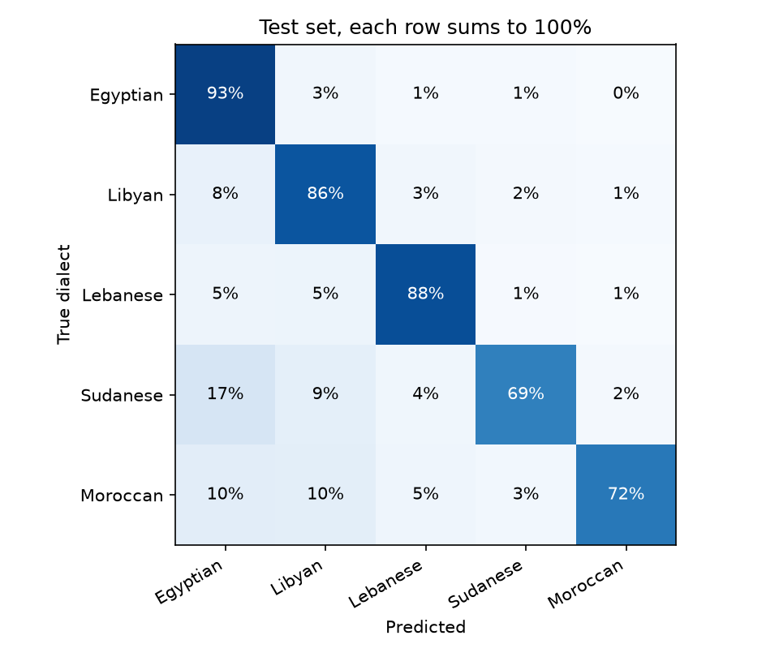

# Arabic Dialect Identification

[](https://github.com/eslammohibrahim/arabic-dialect-id/actions/workflows/tests.yml)

Give it a sentence in Arabic and it guesses where the writer is from: Egypt, Libya, Lebanon, Sudan or Morocco. It was trained on about 118 thousand tweets.

On 14,753 test tweets it never saw, it gets 86.5% right (0.836 macro F1). Saying "Egyptian" for every tweet would already get 39%, because Egyptian is the biggest class, so I picked models by macro F1 and not accuracy.

```text
$ python src/predict.py
Egyptian  | انا مش فاهم انت عايز ايه بالظبط
Lebanese  | شو عم تعمل هلق؟ بدك نطلع سوا
Libyan    | شن تبي توا؟ نبي نمشي للسوق
Moroccan  | واش نتا بخير؟ بغيت نشوفك غدا
Sudanese  | انت داير شنو؟ زول ما عندو موضوع
```

I wrote these five sentences myself to check it works. They're easy on purpose, real tweets are harder.

## Data

[Arabic Dialectical Tweets](https://huggingface.co/datasets/amgadhasan/arabic_tweets_dialects) on Hugging Face (MIT license), 147,725 tweets, each labeled with one country. `src/data.py` downloads it the first time you run anything, it isn't stored in this repo.

The classes are not balanced at all:

| Dialect | Share of train |
|---|---|
| Egyptian | 39.0% |
| Libyan | 24.7% |
| Lebanese | 18.7% |
| Sudanese | 9.7% |
| Moroccan | 7.8% |

Cleaning removed very little. I normalized the text first (same steps as my [sentiment project](https://github.com/eslammohibrahim/arabic-sentiment-analysis): diacritics, alef forms, stretched letters, mentions and links), then dropped tweets under 3 words (116), tweets that appear with two different dialects (44) and duplicates (44). That left 147,521, split 80/10/10 with the same dialect shares in each part.

## Models

Every model got a small search over one setting on the validation set. Features are TF-IDF on words (1-2 grams) or characters (2-5 grams inside words).

| Model | Val accuracy | Val macro F1 |
|---|---|---|
| Always Egyptian | 39.0% | 0.112 |
| Naive Bayes, words | 84.8% | 0.815 |
| Logistic Regression, words | 84.5% | 0.814 |
| Linear SVM, words | 84.6% | 0.815 |
| Linear SVM, characters | 85.5% | 0.825 |
| Linear SVM, words + characters | 86.3% | 0.835 |

Characters beat words, which I think makes sense for dialects. A lot of the difference is in small pieces glued to words, like the "b" in Egyptian "بيعمل" or "عم" before the verb in Lebanese, and the same word gets spelled in many ways on Twitter. Using both was best, so I retrained that one on train + validation and tested it once.

## Results on the test set

| Dialect | Recall |
|---|---|
| Egyptian | 93.4% |
| Lebanese | 88.3% |
| Libyan | 85.6% |
| Moroccan | 72.2% |
| Sudanese | 68.8% |



The two smallest classes are the weakest. 17% of Sudanese tweets get called Egyptian, which isn't too surprising since Sudanese shares a lot of words with Egyptian (مش, كدا, دا), and Egyptian has four times more examples. Moroccan tweets get split between Egyptian and Libyan. I tried nothing for the imbalance yet (class weights would be the first thing to try).

## What the model looks at

The words with the biggest weight for each dialect, from the word part of the model:

| Dialect | Top words |
|---|---|
| Egyptian | ده, يا عم, دول, عندك حق, علشان, ازاي, كام |
| Lebanese | عم, شو, هيك, هيدي, مبارح, رح, بدو |
| Libyan | شن, توا, هكي, هضا, راهو, لين |
| Moroccan | واش, حيت, هاد, ديال, ملي, اخويا |
| Sudanese | ديل, ياخ, دا, ساي, لامن, عديل |

Most of these are real dialect words that any speaker would point to. But some aren't. "مصر" is a top Egyptian word, and "الاتحاد النصر" (two football clubs) is a top Moroccan one. So part of what the model learned is the topics people from each country tweet about, not only how they talk. A tweet about Egyptian football written in Lebanese dialect could fool it.

## Run it

```bash
pip install -r requirements.txt
python src/train.py      # downloads the data, compares models, saves models/dialect_model.joblib (about 5 min on my laptop CPU)
python src/predict.py "ازيك عامل ايه"
pytest -q
```

## Limitations

- Only five dialects. Gulf, Levantine other than Lebanese, Iraqi and others aren't in the data, so a Saudi tweet will still get one of the five labels.
- The dataset card doesn't say how the labels were made. Reading through it, some tweets are in plain MSA with nothing dialect-specific, so no model can get those right except by topic.
- It's trained on tweets, so very short or very formal sentences are harder.

## License

MIT
